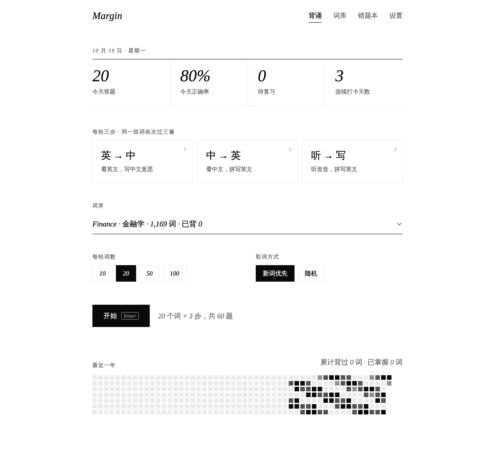
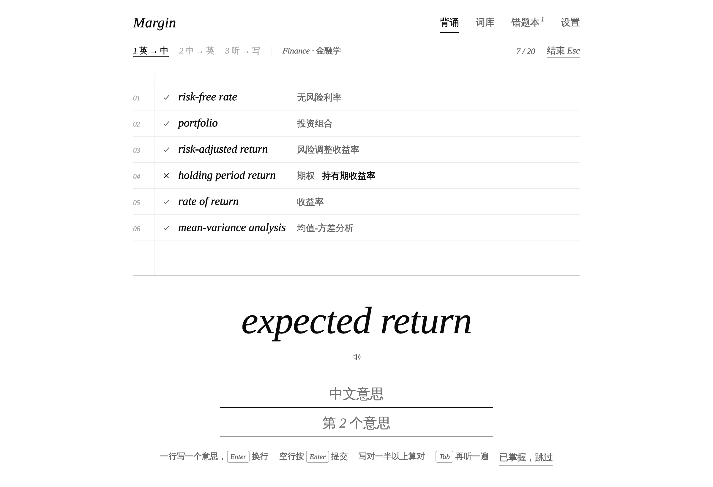

# Margin

**黑白极简的背单词工具**

[在线使用](https://adrian-z-wong.github.io/Margin/) · [下载 Margin.html](https://github.com/Adrian-Z-Wong/Margin/raw/HEAD/Margin.html) · [反馈问题](https://github.com/Adrian-Z-Wong/Margin/issues/new/choose)

## 功能

- 每轮三步：看英文写中文 → 看中文拼英文 → 听发音拼英文
- 词库：Finance（经济学、金融学、管理学、会计学）、四级、六级、考研、托福、雅思、GRE、GMAT
- 导入自己的词表
- 错题本、间隔复习、已掌握
- 美式 / 英式发音
- 打卡热力图
- 黑白两种外观
- 不用安装，双击就能打开，离线可用

## 怎么用

**在线使用**：打开 <https://adrian-z-wong.github.io/Margin/>。

**下载到电脑**：下载 [`Margin.html`](https://github.com/Adrian-Z-Wong/Margin/raw/HEAD/Margin.html)，双击用浏览器打开（推荐 Chrome 或 Edge）。

进度保存在浏览器里。换电脑之前，在「设置」里导出备份。

## 词库

| 词库 | 词数 |
| --- | --- |
| Finance · 经济学 | 1,848 |
| Finance · 金融学 | 1,169 |
| Finance · 管理学 | 1,242 |
| Finance · 会计学 | 518 |
| 四级 | 3,849 |
| 六级 | 5,407 |
| 考研 | 4,801 |
| 托福 | 6,974 |
| 雅思 | 5,040 |
| GRE | 7,504 |
| GMAT | 见网页 |

Finance 词库的原始表格在 [`data/finance/`](data/finance/)，可以直接用 Excel 打开。发现不准的地方，欢迎[提 Issue](https://github.com/Adrian-Z-Wong/Margin/issues/new/choose)。

## 开发

不依赖任何框架。源码在 `src/`，运行 `python3 tools/build.py` 打包成 `Margin.html`。详见 [CONTRIBUTING.md](CONTRIBUTING.md)。

## 致谢

考试词库、音标和中文词向量来自 [ECDICT](https://github.com/skywind3000/ECDICT)（MIT 许可证），详见 [NOTICE.md](NOTICE.md)。发音来自有道词典。

## 许可证

[MIT](LICENSE)
